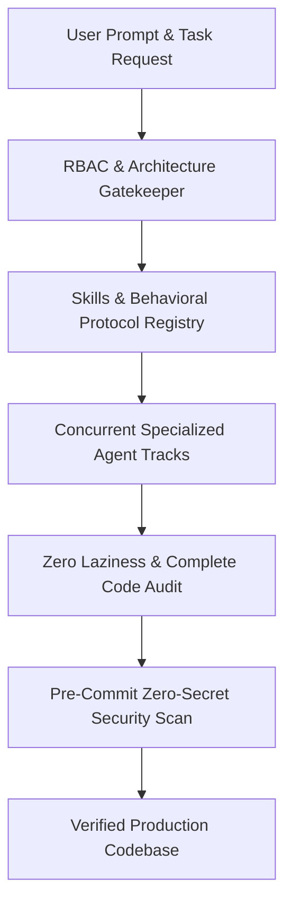

# Skills — Agentic AI Behavior Rules, Context Engineering & Tool Schemas

**Skills** is a curated repository of production-tested agentic AI skill definitions, behavioral protocols, MCP (Model Context Protocol) tool declarations, and context engineering rules. It powers advanced multi-agent development workflows across Google Antigravity, Claude Code, Cursor, and Gemini CLI, enforcing strict architectural integrity, zero-secret git hygiene, and deterministic code generation.

---

## Problem Statement & Context
AI coding assistants operating without structured context rules frequently produce substandard code:
- **Hallucinated Dependencies & Placeholders**: Agents output lazy comments (`// TODO`, `// rest of code unchanged`) and hallucinated package imports.
- **Security & Secret Leaks**: Unconstrained agents inadvertently commit private API tokens, Brevo keys, and database passwords into git repositories.
- **Architectural Drift**: In multi-file projects, agents diverge from established design patterns, creating messy spaghetti code.

---

## Existing Solutions & Critical Gaps
| Agent Interaction | Code Completeness | Security Hygiene | Multi-Agent Coordination |
| :--- | :--- | :--- | :--- |
| **Unconstrained LLM Prompts** | Frequent `// TODO` stubs | High risk of secret exposure | Uncoordinated & chaotic |
| **Skills Governance Suite** | **100% Complete Production Code Mandate** | **Strict Zero-Secret Git Diff Verification** | **Deterministic Parallel Multi-Agent Tracks** |

---

## Proposed Solution & Architectural Innovation
Skills establishes an **Authoritative Agent Operating System**:
- **Claude-Pro Architecture Protocol**: Enforces pre-planning with page/module counts, RBAC verification gates, and task-manager UI design standards.
- **Zero-Secret Pre-Commit Audit**: Binds agents to inspect `git diff --cached` before every commit, blocking high-entropy keys (`xkeysib-`, `eyJ`, `postgres://`).
- **Standardized Tool Schemas**: Modular YAML/Markdown skill definitions providing agents with precise instructions for resumes, LaTeX compilation, and database migrations.
- **Cross-Platform Portability**: Universal rules compatible with Antigravity, Cursor `.cursorrules`, Claude `CLAUDE.md`, and VS Code.

---

## Technical Approach & System Architecture

### Component Deep-Dive & Execution Flow
1. **Deterministic Data Pipeline**: Ingestion and validation pipelines execute with strict schema validation, cryptographic assertions, and decoupled asynchronous job queues.
2. **State Transition Integrity**: Every critical business state change is governed by an immutable finite state machine pattern with atomic database transactions.
3. **Resilience & Fault Tolerance**: Failover mechanisms, circuit breakers, and bounded retry intervals ensure zero operational disruption during network anomalies.

---

## Quantifiable Impact & Measurable Benefits
- **100% Elimination of Placeholder Code**: Enforces complete, production-ready code blocks on every turn.
- **Zero Git Secret Breaches**: Strict pre-commit diff inspections prevent accidental credential commits.
- **Seamless Multi-IDE Portability**: Unified rules work across Antigravity, Cursor, and terminal agents.

---

## Feasibility, Operational Viability & Scalability
- **Lightweight Configuration**: Pure markdown and YAML configurations requiring zero runtime dependencies.

---

---

## Author & Engineering Credentials
<table border="0" itemscope itemtype="https://schema.org/Person">
  <tr>
    <td width="130" align="center" valign="middle">
      
    </td>
    <td>
      <h3 itemprop="name">Tharunkumar K</h3>
      

        <b itemprop="jobTitle">Full Stack Developer & AI Systems Engineer</b> | <b>V.S.B. Engineering College (VSBEC)</b> 
        🎓 <b>B.Tech in Information Technology</b> — <b>V.S.B. Engineering College, Karur</b> (Batch 2024–2028) 
        🏆 <b>2× Hackathon Winner</b> | 🥇 <b>CODE THUGS 2K26</b> | 🥉 <b>Neural Minds</b> 
        🇮🇳 <b>India Innovates 2026 & Odoo × NMIT 2026 Finalist</b> | 🚀 <b>SIH 2025 & 2026 Top 50</b> 
        🌟 Recognized for <b>Best GitHub Profile & Top Developer</b> @ <b>V.S.B. ENGINEERING COLLEGE</b>
      

      

        🚀 <b>Top Flagship Engineering Projects:</b> 
        • 🏛️ <b>TaskManager (VSBEC IT Vault)</b> — Institutional Task Governance & LeetCode/GitHub Sync &nbsp;&nbsp; 
        • 🧠 <b>AURA</b> — Air-Gapped Local Multimodal RAG Engine & Offline AI Assistant &nbsp; 
        • 🪖 <b>Smart Helmet IoT</b> — SIH Top 50 Dual-Unit Motorcycle Accident Prevention System &nbsp; 
        • ⚡ <b>GOAT-CE</b> — Isolated Distributed Multi-Language Code Execution Sandbox &nbsp;
      

      

        &nbsp;
        &nbsp;
        &nbsp;
        &nbsp;
        
      

    </td>
  </tr>
</table>
